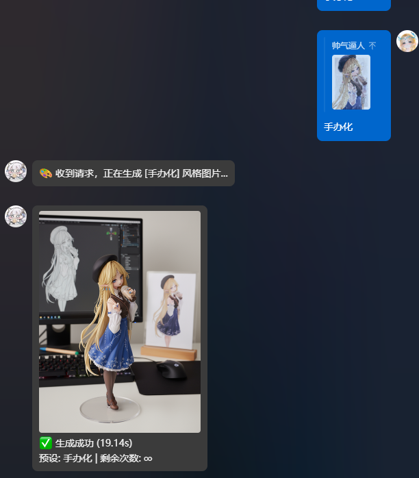
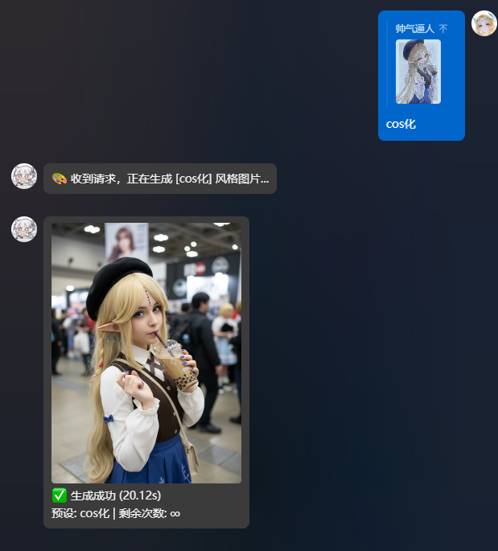
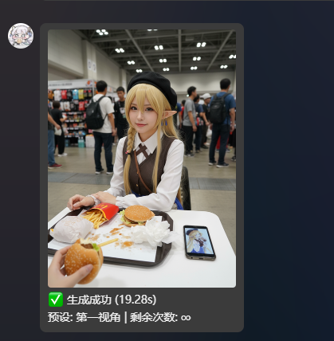
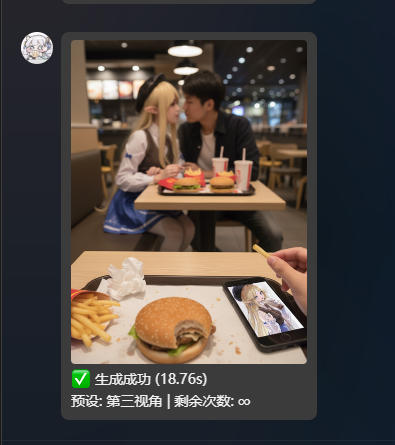

# 🎨 AstrBot 手办工坊 Pro (`astrbot_plugin_shoubanhua`)

基于 [AstrBot](https://github.com/Soulter/AstrBot) 的多功能 AI 图像生成与风格化转换插件。

支持 OpenAI 兼容格式、Gemini 原生路由及 Seedream 协议，提供多模型热备与负载均衡、精细化金额计费和现代化 Web 管理后台。

---

## ✨ 核心特性

- **多风格转换**：内置手办化、Q版化、cos化、痛车化等 30+ 种风格预设，支持直接发图、引用消息或 `@用户` 生成。
- **自由生成与控制**：支持 `#文生图 <描述>` 与 `#bnn <提示词>` 自定义生图；支持 `*倍率` 批量生成，`=比例` 及 `x分辨率` 临时参数覆盖。
- **多模型协议路由**：
  - **OpenAI 兼容**：支持 `/v1/chat/completions`、`/v1/images/generations`、`/v1/images/edits`。
  - **Gemini 原生**：直连 `/v1beta/models/{model}:generateContent` 端点。
  - **厂商高级参数**：支持 GPT、Gemini、Grok、Seedream 专用生图参数，以及 **Omni 视频（flow2api）** 参数模式。
- **Omni 1.1 Flash 视频**：按参数自动拼装实际模型名（`omni-1.1-flash-{时长}s-{横竖}[-{4k|1080p}]`），支持首图横竖自动识别（默认竖屏）、时长分档（4/6/8/10s，默认 8s）、超分辨率开关与目标分辨率，并在「生成完成 → 开始超分」时发送可自定义的阶段提示与两段耗时。
- **高可用热备与负载均衡**：
  - 支持多模型热备映射，故障自动平滑降级。
  - 支持同权重映射模型轮询负载均衡（Round-Robin）。
  - 支持为每个 API Key 单独指定自定义服务地址（`sk-xxx#https://api.example.com`）。
- **精细化计费与签到**：全链路按金额计费（精确至 0.001 元），支持 2K/4K 分辨率差异化扣费、超限阶梯计费与每日签到。
- **现代化 Web 仪表盘**：内置基于 React 18 + Ant Design 5 的管理控制台，支持用量监控、明细对账、余额管理与可视化配置。
- **LLM 生图工具**：支持向 AstrBot 对话模型注册文生图/图生图 Function Calling 工具。

---

## 🚀 快速安装

### 1. 克隆插件
在 AstrBot 的插件目录执行：
```bash
cd astrbot/plugins
git clone https://github.com/misaka-link/astrbot_plugin_shoubanhua.git
```
重启 AstrBot 即可加载插件。

> **提示（Docker / Linux 乱码问题）**：如果预设列表海报生成乱码或全是方块，请安装基础中文字体：
> ```bash
> apt update && apt install -y fonts-dejavu fonts-noto fonts-freefont-ttf
> ```

### 2. 基础配置
在 AstrBot 面板的插件配置或 Web 控制台中设置：
- `generic_api_url`：API 服务地址（如 `https://api.example.com`）。
- `generic_api_keys`：API Key 密钥池（每行一个；支持 `sk-xxx` 或 `sk-xxx#https://custom.api.com` 格式）。
- `model`：默认绘图模型（例如 `gemini-2.5-flash-image`）。

---

## 📖 常用指令

### 1. 生图指令
| 指令 | 说明 | 示例 |
| :--- | :--- | :--- |
| `#手办化` | 将目标图片转为手办风格（支持 `#手办化2`~`6` 衍生风格） | 发送图片配文 `#手办化` |
| `#Q版化` / `#cos化` / `#痛车化` | 常用风格转换指令（30+ 种） | 引用他人图片回复 `#cos化` |
| `#文生图 <描述>` | 纯文字提示词生成图片 | `#文生图 赛博朋克风猫咪` |
| `#bnn <提示词>` | 自定义 Prompt 生图（图生图/文生图） | `#bnn 唯美日系插画，星空` |
| `#bnn*2` / `#bnnx4` / `#bnn=16:9` | 支持倍率、分辨率与比例组合语法 | `#bnn*2x4=16:9 森林日落` |

> 当最终生效模型的参数模式为 `Omni 视频` 时，同样的 `#bnn <提示词>`（可带图）会改为生成视频，详见下方「Omni 1.1 Flash 视频」。

> 完整内置预设（`#手办化`、`#Q版化`、`#痛车化`、`#痛屋化`、`#cos化`、`#cos自拍`、`#第一视角`、`#第三视角`、`#鬼图`、`#贴纸化`、`#fumo化`、`#三视图`、`#3D打印`、`#微型化`、`#真人化` 等）可通过指令 `#手办化列表` 查看效果展示。

### 2. 查询与签到
| 指令 | 说明 |
| :--- | :--- |
| `#手办化签到` | 每日签到获取随机/固定奖励余额 |
| `#手办化查询余额` | 查看自己当前可用余额（元） |
| `#手办化帮助` | 查看帮助文档及模型价格 |
| `#手办化列表` | 生成预设风格海报列表 |

### 3. 管理员指令 (仅管理员)
| 指令 | 说明 |
| :--- | :--- |
| `#切换模型 <模型ID>` | 临时切换当前使用的默认模型 |
| `#手办化增加用户余额 <QQ/@用户> <金额>` | 为指定用户充值余额（元，精确到 0.001） |
| `#手办化增加群组余额 <群号> <金额>` | 为群组公共池充值余额 |
| `#手办化预设增加 <关键词>:<提示词>` | 新增或修改自定义提示词预设 |

---

## 🎬 Omni 1.1 Flash 视频（flow2api）

在模型参数配置里把某个模型的**参数模式**设为 `Omni 视频`（旧字段 `enable_omni_parameters` 亦可），该模型即走视频链路；**入口与生图完全一致**（`#bnn`、自定义前缀、预设、`#文生图` 等），由最终生效模型的参数决定走图片还是视频。

### 实际模型名如何拼装

| 参数 | 默认 | 说明 |
| :--- | :--- | :--- |
| `omni_model_template` | `omni-1.1-flash-{duration}s-{orientation}` | 实际请求模型名模板，支持 `{duration}`/`{orientation}`/`{resolution}`/`{model}` |
| `omni_video_duration` | `8` | 4 / 6 / 8 / 10 秒，写进模型名 |
| `omni_aspect_mode` | `auto` | `auto`=按**第一张参考图**宽高识别横竖；`portrait`/`landscape` 强制 |
| `omni_default_aspect` | `portrait` | 无图、读图失败或正方形时使用的方向（**默认竖屏**） |
| `omni_super_resolution` | 关闭 | 开启后在模型名后追加 `-1080p` / `-4k` |
| `omni_super_resolution_target` | `1080p` | `1080p` / `4k` |
| `omni_agent_ui` | `default`（不传） | 对应 flow2api 顶层 `agent_ui`：`on` / `off` / `keep`（也认 开/关/保持），仅视频、仅部分后端生效 |

例如：8 秒竖屏 + 4K 超分 → `omni-1.1-flash-8s-portrait-4k`；4 秒横屏不超分 → `omni-1.1-flash-4s-landscape`。

> 视频请求固定 `stream: true`，并附带 `generationConfig.imageConfig.aspectRatio/imageSize`，以兼容 flow2api 的简化模型名解析（注意：`generationConfig` 只对**基础别名**生效，本插件默认直接用完整模型 id，所以方向/时长/超分全部由模型名承载）。

> **SSE 契约（务必按此解析）**：flow2api 的过程文字（"视频生成中..."、"生成进度: 42%"、"视频生成完成，开始 4K 放大处理..."）走 `choices[0].delta.reasoning_content`，**只有终态产物**走 `choices[0].delta.content` + `finish_reason: "stop"`，以 `data: [DONE]` 收尾。插件已按此实现（进度与产物分开累积）。

### 超分阶段提示与两段耗时

上游（flow2api）是「先生成、再放大」两步，流式响应里会出现 `视频生成完成，开始 4K 放大处理...`。插件据此切分：

```
请求发出 ──► 命中 omni_upscale_start_pattern ──► 收到最终视频地址
              （发送 omni_upscale_start_message，生成耗时 = t1 - t0）
                                                （超分耗时 = t2 - t1）
```

| 参数 | 默认 | 说明 |
| :--- | :--- | :--- |
| `omni_upscale_start_message` | `🎬 视频已生成（生成耗时 {generate_time}），开始 {resolution} 超分辨率处理，请稍候…` | 阶段提示，**可自定义模板** |
| `omni_upscale_start_pattern` | `视频生成完成.*?放大` | 识别阶段切换的正则（在 `reasoning_content` 里匹配），上游改文案时可调 |
| `omni_result_caption` | `✅ 视频生成完成 \| 生成耗时 {generate_time} \| 超分耗时 {upscale_time}` | 随视频发送的文案 |
| `omni_show_timing` | 开启 | 是否在完成文案中保留两段耗时 |
| `omni_send_orig_video` | 开启 | 上游流出「原视频: \<url\>」（超分前基础片）时，**立刻下载并当视频发出**，作为超分等待期的中间预览 |
| `omni_orig_video_pattern` | `原视频[:：]\s*(https?://\S+)` | 识别「超分前原视频 URL」的正则（第 1 个捕获组为 URL） |
| `omni_orig_video_caption` | `🎬 超分前原片 · {resolution} 超分处理中，完成后发送超分版` | 随原视频一起发送的文案 |
| `omni_send_preview_gif` | **关闭** | 上游 2026-10-08 已下架 GIF 下载变体，默认不再取/发 GIF |
| `omni_timeout` | `2400` | 单次视频请求读超时（秒）。上游视频几分钟到几十分钟，带超分额外可能 ~30 分钟，官方建议 ≥1800s |
| `omni_max_reference_images` | `3` | 参考图上限（上游最多 3 张，按顺序即语义） |

模板变量：`{generate_time}`、`{upscale_time}`、`{resolution}`、`{duration}`、`{orientation}`、`{orientation_cn}`、`{model}`、`{cost}`、`{preview_gif}`。

> **中间预览（超分前原片）**：flow2api 目前**不会**把超分前基础片的 URL 流给调用方，因此插件已按「**有则用、无则跳过**」实现 —— 一旦上游在阶段标记处补上 `原视频: <url>` 这一行，插件会立即下载并作为视频发出，无需再改插件。GIF 预览因上游下架已默认关闭。

### 计费

按时长分档：`omni_charge_amount_4s/6s/8s/10s`（元），填 `0` 时继承该模型的「该模型单次生成扣费」；开启超分再叠加 `omni_upscale_extra_charge`。视频不支持 `*倍率` 批量。

### 视频素材输入（图 + 视频统一保序）

插件支持把**用户引用的视频**当作参考素材传给 flow2api（与参考图同等地位）。

- **顺序即语义**：一趟走完、按 `content` 顺序统一收集「图 + 视频」，顺序为
  **引用链（最前）→ 当前消息 → @用户头像（最后）**
  （`ImageWorkflow.get_assets_ordered()`；旧的 `get_images`/`get_videos` 保留但不再用于主链路）
- **请求体形态**：`content` 数组里图用 `{"type":"image_url"}`、视频用 `{"type":"video_url"}`
- **视频传法**（自动选择）：
  - 视频 ≤ `OMNI_VIDEO_INLINE_LIMIT`（默认 **60MB**）→ 内联 `data:video/mp4;base64,…`
  - 超过 → `POST {base}/v1/uploads/video`（原始字节直传，`X-File-Name`）→ 拿 `upload_id`
    → 发 `upload://<upload_id>`（由 flow2api 在生成时自动 commit 进本次项目）
  - 上传失败 → **跳过该素材**并报错日志，绝不伪造
- **上限**：参考图受 `omni_max_reference_images` 限制，参考视频受 `ImageWorkflow.max_videos`（默认 2）限制；
  两者**分别限流但保持相对顺序**
- **上游约束**：仅 **broker 后端 + `r2v`/`omni` 模型**支持；否则 `400 video_asset_unsupported`；
  Flow 侧限 ≤1GB、`mp4/m4v/mov/3gp/avi`、**>30s 需裁剪**
- **只有视频没有图**时不会回退发送者头像、也不再报「请发送或引用一张图片」

> 注：视频走 `_load_video_bytes()`，**不做首帧抽取**（区别于图片的 `_load_bytes()`）。

### 注意事项（来自 flow2api 官方调用文档）

- **视频单独成一条消息**：QQ(aiocqhttp) 等平台要求「video 段必须是消息里唯一的段」，否则会 `retcode=1400 message element "video" must be the only segment`。插件因此把**文案先单独发一条，视频再单独发一条**；视频直链失败会自动下载后发本地文件，再失败才回落发链接。
- **产物是临时缓存**：返回的 `/tmp/<file>` 有效期默认 **7200 秒**，过期 404。插件发送时会让 AstrBot 下载视频，等于已转存；若发送失败回落为「发链接」，请尽快手动保存。
- **超分很慢**：带 `-1080p` / `-4k` 的模型是「先生成、再放大」，额外可能等 ~30 分钟；`omni_timeout` 默认已放宽到 2400 秒。
- **同一账号视频任务串行**（1 并发），并发提交会排队。
- **素材顺序即语义**：参考图按数组顺序，插件已保序发送，不做排序/去重。
- **内容政策**：含真人公众人物的输入会被上游直接拒绝（`content_violation`），与账号/风控无关。

---

## 🖥️ Web 管理仪表盘

插件自带基于 React 18 + Ant Design 5 的独立管理控制台（访问 AstrBot WebUI 插件页面即可进入）：
- **用量与监控**：实时查看调用成功率、每日费用消耗、模型与端点分布。
- **账本审计**：按日期和调用状态筛选请求流水，支持查看耗时与实际扣费金额。
- **余额调整**：直观管理用户与群聊公用额度，支持批量操作。
- **配置与路由**：可视化配置 Key 池、模型映射热备、负载均衡权重与模型厂商参数。

---

## 🎨 效果展示

| `#手办化` | `#cos化` |
| :---: | :---: |
|  |  |
| **#第一视角** | **#第三视角** |
|  |  |

---

## 📄 开源许可与致谢

- 本项目基于 [shskjw/astrbot_plugin_shoubanhua](https://github.com/shskjw/astrbot_plugin_shoubanhua) 进行重构与二次开发，感谢原作者 @shskjw 与开源社区的贡献支持！
- 本插件遵循 [GNU AGPLv3](./LICENSE) 协议开源。
